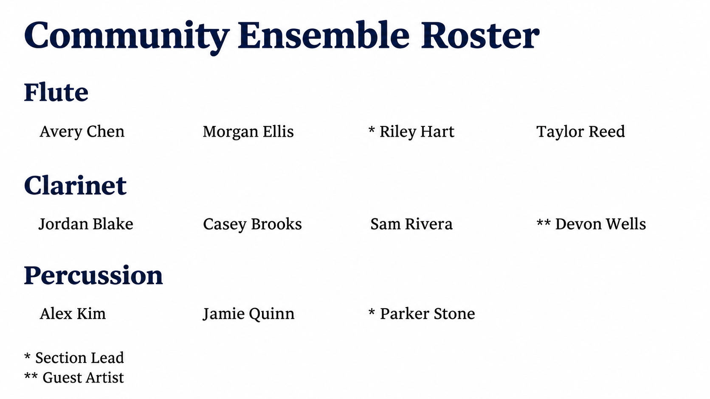

# Roster

Roster is a public Joomla site module for an editable, sectioned member roster. It is designed for Joomla 5 and Joomla 6. The public page places a prominent title above ordered section headings, displays names in a clean four-column grid that adapts to smaller screens, and ends with a legend explaining special markings. The administrator panel uses the navy, blue, teal, and card styling of Volunteer Tracker.



The preview uses invented names and sample sections and flags.

## Requirements

- Joomla 5.x or 6.x
- PHP 8.1 or newer for Joomla 5; PHP 8.3 or newer for Joomla 6
- Joomla administrator access to install and edit site modules

## Install and display

1. Download `mod_roster-0.0.1.zip` from the [releases page](https://github.com/kanebrands/roster-generator/releases), or build it from this source tree.
2. In Joomla administrator, go to **System > Install > Extensions** and upload the ZIP.
3. Go to **Content > Site Modules**, open **Roster**, and enter the roster content on the **Module** tab.
4. Set **Status** to Published and **Show Title** to Hide. The **Page title** setting supplies the public heading.
5. To make a dedicated public page, create a Joomla article with `{loadmoduleid MODULE_ID}` and link a menu item to that article. Enable Joomla's **Content - Load Modules** plugin if needed. Replace `MODULE_ID` with the numeric ID of the published Roster module. Alternatively, assign the module to a template position and menu items.

## Edit the roster

- **Page title:** Heading shown above the roster.
- **Sections:** Add, rename, remove, and reorder headings. An empty section still displays its heading.
- **Members:** Add, edit, remove, and reorder people. Enter one or more *existing section headings*, one per line, in **Assigned sections**. A member assigned to two sections appears in both. Section names must match exactly, including capitalization. If you rename a section, update its member assignments too.
- **Marking:** Enter a symbol such as `*` or `**` on a member row.
- **Legend:** Add each marking and its meaning, such as `*` = `Section Leader`.
- **Import roster:** Paste or upload a `.txt` file with `**Section**` headings and one name per line, or a CSV with `Name, Section, Flags` columns. Trailing markers such as `Jane Smith*` become flags. Repeat a person on separate CSV rows to assign multiple sections. Matching names and section headings are merged case-insensitively; imported flags replace existing flags for matching members. Review the editor rows and save to persist the import.
- **Preview roster:** Click **Preview roster** to render the current editor values before saving or publishing. The preview is visible only in the administrator editor.

Create additional rosters with **Content > Site Modules > New > Roster**. Each module instance has separate content, publication status, and menu assignment. Use its module ID in a different article to give each roster a dedicated public page.

Member order in the editor controls order within every assigned section. Public output uses four columns on wide screens, two on medium screens, and one on phones. Text is escaped before it reaches the page.

Module settings are stored by Joomla with the module record. No separate database tables or external services are used.

## Updates and releases

The installer registers `updates/mod_roster.xml` as the Joomla update feed. Each release must update the version in `mod_roster.xml`, the feed version, and the feed's release ZIP URL. Push the feed change to `main`, then push a matching `vX.Y.Z` tag. The [release workflow](.github/workflows/release.yml) packages the module and uploads `mod_roster-X.Y.Z.zip` to the GitHub release. Joomla's extension updater can then discover that release.

To build locally:

```sh
python3 scripts/build.py
```

The generated ZIP is placed in `dist/`. For removal, use **System > Manage > Extensions**, select **Roster**, and uninstall it. Joomla removes the module settings with the module instance, so copy any roster data you need first.

## Development checks

```sh
find services src tmpl -name '*.php' -print0 | xargs -0 -n1 php -l
python3 scripts/check.py
node --check media/js/admin-import.js
node scripts/test-import.js
php -d zend.assertions=1 scripts/test-render.php
python3 scripts/build.py
```

Syntax and package checks do not replace installation checks in disposable Joomla 5 and Joomla 6 sites. Verify the module editor, add/edit/delete flows, multi-section assignments, output, and update discovery there before using a live site.
